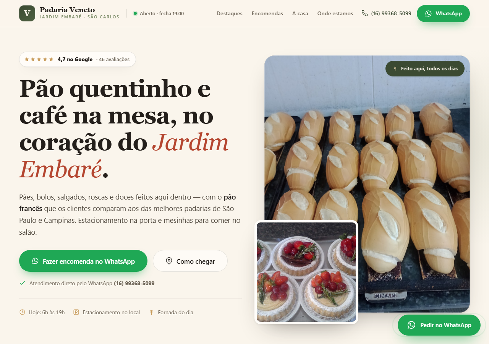

# Padaria Veneto — Landing Page

> Landing page de uma padaria de bairro em São Carlos/SP, feita com **HTML, CSS e JavaScript puro** — sem framework, sem build e **sem nenhuma dependência em produção**.

**Demo:** https://roldan-eng-software.github.io/padaria-veneto/

[](#html-semântico-e-seo)
[](#css-organizado)
[](#javascript-com-clean-code)
[](#testes-automatizados)
[](#como-rodar)

<p align="center">
  
  
</p>

---

## Sumário

- [Sobre este projeto](#sobre-este-projeto)
- [O que este repositório demonstra](#o-que-este-repositório-demonstra)
- [Stack e decisões técnicas](#stack-e-decisões-técnicas)
- [Estrutura de arquivos](#estrutura-de-arquivos)
- [Como rodar](#como-rodar)
- [Funcionalidades](#funcionalidades)
- [JavaScript com Clean Code](#javascript-com-clean-code)
- [CSS organizado](#css-organizado)
- [HTML semântico e SEO](#html-semântico-e-seo)
- [Acessibilidade](#acessibilidade)
- [Testes automatizados](#testes-automatizados)
- [Resultados dos testes de eficiência](#resultados-dos-testes-de-eficiência)
- [Testes de segurança](#testes-de-segurança)
- [Configuração do negócio](#configuração-do-negócio)
- [Publicação](#publicação)
- [Próximos passos](#próximos-passos)
- [Créditos](#créditos)

---

## Sobre este projeto

Este projeto faz parte do meu portfólio. A escolha por **não usar framework** foi intencional: o site é majoritariamente estático, então uma biblioteca adicionaria peso, complexidade e dependências sem resolver nenhum problema real.

O resultado é uma página que:

- carrega **HTML + CSS + JS com ~26 KB gzip** (sem contar as fotos);
- funciona em qualquer host estático (GitHub Pages, Netlify, Vercel, cPanel);
- tem **testes automatizados de funcionalidade, eficiência e segurança**;
- foi refatorada para separar responsabilidades: conteúdo, estilo e comportamento em arquivos distintos.

---

## O que este repositório demonstra

| Habilidade                                         | Onde ver                                                 |
| -------------------------------------------------- | -------------------------------------------------------- |
| HTML semântico, SEO técnico e acessibilidade       | `index.html`                                             |
| CSS moderno, responsivo e organizado por seções    | `styles.css`                                             |
| JavaScript puro, modular e testável                | `scripts.js`                                             |
| Testes end-to-end em desktop e mobile              | `tests/functional.spec.mjs`                              |
| Testes de performance com orçamento (budget)       | `tests/performance.spec.mjs`                             |
| Testes de segurança e privacidade                  | `tests/security.spec.mjs`                                |
| Consciência de Core Web Vitals (CLS, carregamento) | seção [Resultados](#resultados-dos-testes-de-eficiência) |
| Documentação e cuidado com o próximo dev           | este README                                              |

---

## Stack e decisões técnicas

| Camada        | Escolha                                               | Por quê                                                       |
| ------------- | ----------------------------------------------------- | ------------------------------------------------------------- |
| Estrutura     | HTML5 semântico                                       | Leitores de tela, SEO e manutenção                            |
| Estilo        | CSS3 com Grid, Flexbox, `clamp()` e custom properties | Responsivo sem pré-processador                                |
| Comportamento | JavaScript ES2020+                                    | `Intl`, `IntersectionObserver`, módulos por função            |
| Fontes        | Fraunces + Inter auto-hospedadas                      | Zero requisição ao Google Fonts, menos CLS e mais privacidade |
| Testes        | Playwright                                            | Testa o site real em Chromium desktop e mobile                |
| Formatação    | Prettier                                              | Estilo consistente em HTML, CSS e JS                          |
| Build         | Nenhum                                                | O que está no repositório é o que vai para produção           |

**Runtime:** apenas `index.html`, `styles.css`, `scripts.js` e a pasta `fonts/`.
**Ferramentas de desenvolvimento:** Node.js 20+, Playwright e Prettier (apenas para testes e formatação).

### Por que as fontes são auto-hospedadas?

A versão inicial carregava as fontes do Google. Nos testes, isso gerou **CLS de 0,371** (a fonte trocava depois do primeiro paint e o texto "pulava").
A correção foi:

1. baixar apenas o subset `latin` das fontes variáveis;
2. servi-las do próprio domínio;
3. usar `<link rel="preload" as="font">`;
4. aplicar `font-display: optional`, que evita a troca tardia de fonte.

Resultado: **CLS 0** e queda no tempo de `load` de ~2.987 ms para ~640 ms no ambiente de teste. Detalhes na seção de [resultados](#resultados-dos-testes-de-eficiência).

---

## Estrutura de arquivos

```text
.
├── index.html                  # Conteúdo, metadados de SEO e sprite de ícones
├── styles.css                  # Todo o visual, organizado em 22 seções
├── scripts.js                  # Interatividade organizada em 13 módulos
├── fonts/                      # Fraunces e Inter (woff2) + licenças OFL
├── docs/                       # Capturas de tela usadas neste README
├── tests/
│   ├── functional.spec.mjs     # 11 cenários funcionais
│   ├── performance.spec.mjs    # 2 cenários de eficiência
│   └── security.spec.mjs       # 6 cenários de segurança
├── reports/                    # Métricas geradas na última execução dos testes
├── scripts/
│   └── dev-server.mjs          # Servidor estático mínimo, sem dependências
├── playwright.config.mjs       # Projetos desktop + mobile
├── package.json                # Scripts de dev, teste e formatação
└── .prettierrc.json
```

> Não existe pasta `dist/` nem etapa de compilação: os arquivos são os artefatos finais.

---

## Como rodar

### Sem instalar nada

Abra `index.html` no navegador. O site funciona direto do sistema de arquivos.

### Com servidor local (recomendado)

```bash
npm install       # instala apenas ferramentas de desenvolvimento
npm run dev       # http://127.0.0.1:4173
```

O servidor em `scripts/dev-server.mjs` não tem dependências, bloqueia _path traversal_ e envia `X-Content-Type-Options: nosniff`.

### Comandos disponíveis

| Comando                | O que faz                                          |
| ---------------------- | -------------------------------------------------- |
| `npm run dev`          | Sobe o site em `http://127.0.0.1:4173`             |
| `npm test`             | Executa os 38 testes Playwright (desktop + mobile) |
| `npm run test:ui`      | Abre o modo interativo do Playwright               |
| `npm run test:report`  | Abre o relatório HTML da última execução           |
| `npm run format`       | Formata o projeto com Prettier                     |
| `npm run format:check` | Verifica se o código está formatado                |

Na primeira execução dos testes, instale o navegador:

```bash
npx playwright install chromium
```

---

## Funcionalidades

| Funcionalidade                    | Como funciona                                                                                                      | Conceitos demonstrados                               |
| --------------------------------- | ------------------------------------------------------------------------------------------------------------------ | ---------------------------------------------------- |
| **Aberto agora / Fechado**        | Calcula o horário no fuso `America/Sao_Paulo`, independentemente do fuso do visitante, e mostra a próxima abertura | `Intl.DateTimeFormat`, funções puras                 |
| **Links de WhatsApp dinâmicos**   | Elementos com `data-wa` recebem `href` com mensagem pré-preenchida e codificada                                    | `encodeURIComponent`, separação dado × DOM           |
| **Formulário de encomenda**       | Valida campos, foca o primeiro erro e monta uma mensagem pronta para o WhatsApp                                    | Validação, foco acessível, funções puras             |
| **Faixa de delivery condicional** | Só aparece quando há links configurados no `CONFIG`                                                                | Renderização condicional sem framework               |
| **Analytics opcional**            | GA4 e Meta Pixel só são carregados se houver ID configurado                                                        | Privacidade por padrão, baixo custo quando desligado |
| **Galeria com lightbox**          | Abre a foto ampliada, fecha com `Esc` ou clique fora e devolve o foco ao link                                      | Diálogo acessível, gerenciamento de foco             |
| **Mapa sob demanda**              | O iframe do Google Maps só é criado depois do clique                                                               | Redução de requisições no primeiro carregamento      |
| **Animação de entrada**           | Elementos aparecem ao entrar na viewport                                                                           | `IntersectionObserver`, `prefers-reduced-motion`     |
| **Fallback de imagens**           | Se uma foto externa falhar, um cartão da padaria assume o lugar                                                    | Tratamento defensivo de erro                         |
| **Menu mobile**                   | Abre/fecha com `aria-expanded`, fecha com `Esc` e ao clicar em um link                                             | Acessibilidade e navegação por teclado               |

---

## JavaScript com Clean Code

`scripts.js` é um arquivo único, mas internamente modular. Cada responsabilidade tem sua função de inicialização:

```js
const init = () => {
  initWhatsAppLinks();
  initAnalytics();
  initClickTracking();
  initDeliveryBand();
  renderOpeningStatus();
  initHeaderMenu();
  initOrderForm();
  initScrollReveal();
  initMap();
  initLightbox();
  initImageFallback();
  initFooterYear();
};
```

### Princípios aplicados

- **Dados centralizados:** tudo que o negócio precisa editar está em `CONFIG`.
- **Lógica pura separada do DOM:** `getOpenState`, `buildOrderMessage` e `whatsappUrl` não tocam na página, então são fáceis de testar.
- **Funções pequenas e com nomes claros:** `setMenuState`, `setFieldError`, `formatFriendlyTime`.
- **Sem estado global implícito:** cada módulo inicializa apenas o que é seu.
- **Sem `eval`, `new Function`, `fetch` ou `XMLHttpRequest`:** o site não envia dados para servidor.
- **Tratamento de erro intencional:** o `track()` nunca quebra a página se o analytics falhar.
- **API mínima e congelada para testes:** `window.PadariaVeneto` expõe apenas o necessário.

Exemplo de lógica pura coberta por teste:

```js
// segunda-feira, 20h → já fechou; próxima abertura é terça às 06:00
getOpenState(1, 20 * 60);
// { isOpen: false, label: "Fechado · abre amanhã 06:00" }
```

E o teste correspondente:

```js
expect(await page.evaluate(() => window.PadariaVeneto.getOpenState(1, 20 * 60))).toEqual({
  isOpen: false,
  label: "Fechado · abre amanhã 06:00",
});
```

---

## CSS organizado

`styles.css` começa com um índice de 22 seções (fontes, tokens, reset, utilitários, botões, header, hero, etc.) e segue essa ordem no arquivo.
Isso evita o clássico "CSS de 2.000 linhas sem mapa".

Destaques técnicos:

- **Custom properties** para paleta, tipografia, raios e sombras;
- **Grid + Flexbox** para os layouts;
- **`clamp()`** para tipografia e espaçamentos fluidos;
- **Mobile ajustado por breakpoints** em `1040px`, `900px`, `860px` e `560px`;
- **`prefers-reduced-motion`** desliga animações;
- **Zero `style=""` no HTML** — todo estilo vive no CSS;
- **Sem `!important`** exceto na regra de impressão e na redução de movimento (necessárias).

---

## HTML semântico e SEO

- Um único `<h1>`, hierarquia de headings consistente e `main`/`section`/`nav`/`footer`.
- `title` e `description` específicos para a padaria e a região.
- **Open Graph** e **Twitter Card** para compartilhamento.
- **JSON-LD** do tipo `Bakery` com endereço, telefone, geolocalização, horários, nota e avaliações.
- `canonical`, `lang="pt-BR"`, meta `geo.*` e `theme-color`.
- Imagens com `width`, `height`, `alt`, `loading="lazy"` e `srcset` no hero.

O teste `security.spec.mjs` valida que o JSON-LD continua sendo um JSON válido do tipo `Bakery`.

---

## Acessibilidade

- Link **"Pular para o conteúdo"** no topo.
- Foco visível (`:focus-visible`) em todos os elementos interativos.
- `aria-expanded`, `aria-controls` e troca de rótulo no menu mobile.
- Lightbox fecha com `Esc` e devolve o foco ao item que o abriu.
- Todos os campos têm `<label for>` associado.
- Todas as imagens têm texto alternativo.
- `prefers-reduced-motion` respeitado.
- Estrutura navegável por teclado.

Os testes automatizados cobrem o básico (um `h1`, `alt`, labels, menu e lightbox). Uma auditoria completa com `axe-core` está no
[roadmap](#próximos-passos).

---

## Testes automatizados

**Filosofia do projeto:** uma entrega só é considerada pronta depois de passar por testes de **eficiência** e **segurança**, além dos testes funcionais.

A suíte roda em dois projetos Playwright — **desktop (1280×720)** e **mobile (Pixel 5)** — totalizando **38 testes**.

| Arquivo                | Cenários por dispositivo | O que cobre                                                                                                    |
| ---------------------- | ------------------------ | -------------------------------------------------------------------------------------------------------------- |
| `functional.spec.mjs`  | 11                       | CSS/JS separados, WhatsApp, status, menu, formulário, lightbox, mapa, delivery, acessibilidade e ano do rodapé |
| `performance.spec.mjs` | 2                        | Orçamento de carregamento e verificação de recursos locais                                                     |
| `security.spec.mjs`    | 6                        | `noopener`, URLs `javascript:`, handlers inline, HTTPS, `eval`/`fetch` e segredos                              |

Execução mais recente:

```text
Running 38 tests using 4 workers
38 passed
```

### Como os testes de eficiência funcionam

O teste mede, no navegador real:

- **TTFB** (`responseStart`);
- **DOMContentLoaded** e **load**;
- **quantidade de nós no DOM**;
- **Layout Shift Cumulativo (CLS)** via `PerformanceObserver`;
- **erros de console e de página**;
- **recursos externos** carregados;
- **falhas de recursos locais**.

Se qualquer métrica estourar o orçamento, o teste falha. O relatório é salvo em `reports/performance-desktop.json` e
`reports/performance-mobile.json`.

---

## Resultados dos testes de eficiência

Última execução: **22/10/2026**, Chromium 156 via Playwright 1.64, servidor local.

| Métrica                  |   Orçamento |       Desktop |        Mobile |
| ------------------------ | ----------: | ------------: | ------------: |
| TTFB                     |  < 1.500 ms |     **28 ms** |     **33 ms** |
| DOMContentLoaded         |  < 3.000 ms |    **595 ms** |    **694 ms** |
| Load                     | < 15.000 ms |    **638 ms** |    **762 ms** |
| Nós no DOM               |     < 2.500 |       **656** |       **656** |
| CLS                      |       < 0,1 |         **0** |         **0** |
| Erros de console         |           0 |         **0** |         **0** |
| Erros de página          |           0 |         **0** |         **0** |
| Recursos externos        |           — | **7** (fotos) | **6** (fotos) |
| Imagens com lazy loading |           — |  **15 de 17** |  **15 de 17** |

Relatórios completos: [`reports/performance-desktop.json`](reports/performance-desktop.json) e
[`reports/performance-mobile.json`](reports/performance-mobile.json).

### O que os testes já encontraram e como foi corrigido

| Problema detectado           | Diagnóstico                                                            | Correção                                                      | Resultado                      |
| ---------------------------- | ---------------------------------------------------------------------- | ------------------------------------------------------------- | ------------------------------ |
| CLS de **0,371** no desktop  | Fontes do Google trocavam depois do primeiro paint e o texto reflowava | Fontes auto-hospedadas + `preload` + `font-display: optional` | CLS **0**                      |
| `load` de **~2.987 ms**      | Dependência de CDN externo para fontes e conexões extras               | Remoção do Google Fonts (3 arquivos locais)                   | `load` **~640 ms**             |
| Imagem do lightbox sem `alt` | `` no diálogo                                       | `alt` descritivo e remoção do `src` vazio                     | Teste de acessibilidade passou |

> Tempos variam conforme máquina e rede. O que o projeto garante são os **orçamentos** — se uma métrica piorar, o CI/teste acusa.

### Tamanho do que vai para produção

| Arquivo      | Tamanho |        Gzip |
| ------------ | ------: | ----------: |
| `index.html` | 57,5 KB | **11,5 KB** |
| `styles.css` | 38,6 KB |  **7,8 KB** |
| `scripts.js` | 21,6 KB |  **6,8 KB** |
| **Total**    |       — |  **~26 KB** |

As 3 fontes locais somam ~154 KB e ficam em cache após o primeiro acesso.

---

## Testes de segurança

O site é estático, então os riscos relevantes são outros: _tabnabbing_, injeção por URL, conteúdo misto, vazamento de dados do
formulário e dependências de terceiros.

| Verificação                                             | Como é testado                                                          |
| ------------------------------------------------------- | ----------------------------------------------------------------------- |
| Links com `target="_blank"` têm `noopener`/`noreferrer` | Percorre todos os `<a>` no DOM                                          |
| Nenhuma URL `javascript:`                               | Inspeciona todos os `href`                                              |
| Nenhum handler inline (`onclick`, `onerror` etc.)       | Percorre todos os atributos do DOM                                      |
| Recursos externos usam HTTPS                            | Verifica `src`/`href` de imagens, scripts e links                       |
| Formulário não envia dados a servidor                   | Garante que não há `action` e que o JS não usa `fetch`/`XMLHttpRequest` |
| Sem `eval`, `new Function` ou `document.write`          | Análise estática de `scripts.js`                                        |
| Sem credenciais ou segredos no código                   | Varredura dos arquivos-fonte                                            |
| JSON-LD válido                                          | Parse do bloco `application/ld+json`                                    |

### Privacidade e LGPD

- **Nenhum analytics é carregado por padrão**: GA4 e Meta Pixel só entram se um ID for configurado.
- A encomenda **não passa por servidor**: o formulário apenas monta uma mensagem e abre o WhatsApp — o envio só acontece quando o
  visitante confirma no aplicativo.
- As fotos atuais vêm do perfil público do Google Maps (crédito no rodapé). A recomendação é substituí-las por imagens próprias
  em WebP.

### Limitações e próximos passos de segurança

GitHub Pages não permite cabeçalhos HTTP personalizados. Para produção, o ideal é publicar atrás de um CDN/proxy que adicione:

- `Content-Security-Policy`;
- `Strict-Transport-Security`;
- `Referrer-Policy`;
- `Permissions-Policy`.

---

## Configuração do negócio

Tudo que muda com frequência está em `CONFIG`, no início de `scripts.js`:

```js
const CONFIG = {
  nome: "Padaria Veneto",
  telefone: "+5516993685099",
  timezone: "America/Sao_Paulo",
  hours: [
    { day: 1, label: "Segunda", open: "06:00", close: "19:00" },
    // ...
  ],
  delivery: {
    ifood: "", // preencha para a faixa de delivery aparecer
    anotaai: "",
    propria: "",
  },
  ga4: "", // ex.: "G-XXXXXXXXXX"
  pixel: "", // ex.: "1234567890"
  mensagens: {
    padrao: "Olá, Padaria Veneto! Vi o site e gostaria de falar com vocês.",
    // ...
  },
};
```

### Trocar as fotos

1. Salve as imagens em `fotos/` (ou em um CDN), de preferência em **WebP** com ~1200 px de largura.
2. Substitua as URLs `https://lh3.googleusercontent.com/...` no `index.html`.
3. Atualize o `alt` de cada imagem.

O fallback de imagens continua funcionando: se uma foto falhar, aparece um cartão com o nome da padaria.

### Trocar o domínio

Quando houver domínio próprio, atualize:

1. `<link rel="canonical">`;
2. `og:url`;
3. campos `"url"` e `"@id"` do JSON-LD.

---

## Publicação

O site já está publicado no **GitHub Pages** (branch `main`, pasta raiz). Qualquer `git push` na `main` republica em 1–2 minutos.

Outros hosts estáticos funcionam sem alteração:

- **Netlify / Vercel:** arraste a pasta no painel;
- **Cloudflare Pages:** conecte o repositório;
- **Hostinger/cPanel:** envie os arquivos para `public_html`.

Como não há build, não é necessário configurar comando de build nem pasta de saída.

---

## Próximos passos

- [ ] Substituir as fotos do Google por fotos próprias em WebP.
- [ ] Confirmar com a padaria: entrega própria, formas de pagamento e prazo de encomendas.
- [ ] Adicionar testes de acessibilidade com `axe-core`.
- [ ] Rodar a suíte em **GitHub Actions** a cada pull request.
- [ ] Adicionar CSP e headers de segurança via CDN/proxy.
- [ ] Avaliar consentimento de cookies antes de ativar GA4/Pixel (LGPD).

---

## Créditos

- **Fotos:** perfil público da Padaria Veneto no Google Maps (crédito no rodapé do site).
- **Fontes:** [Fraunces](https://github.com/undercasetype/Fraunces) e [Inter](https://github.com/rsms/inter), sob SIL Open Font License.
  As licenças estão em [`fonts/`](fonts/).
- **Ícones:** desenhados como sprite SVG inline no `index.html`.

## Licença

Este projeto é disponibilizado para fins de portfólio e avaliação técnica. A marca, os textos e as fotos da Padaria Veneto
pertencem aos seus respectivos donos.
